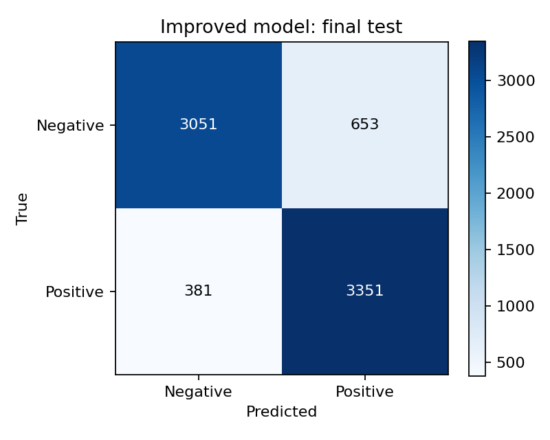
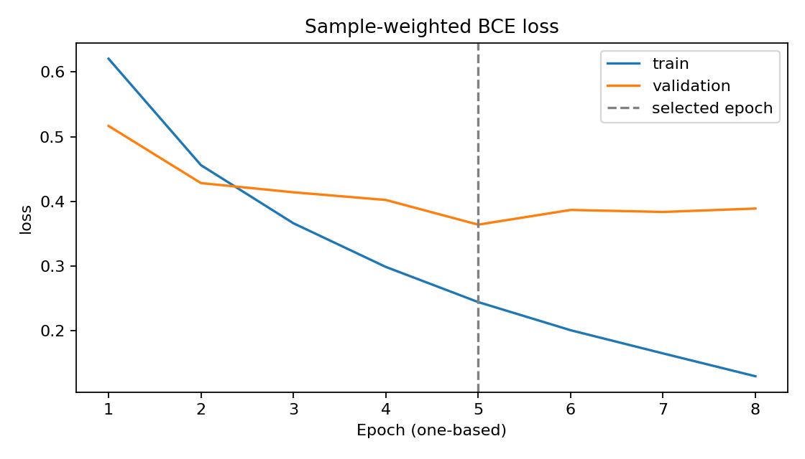
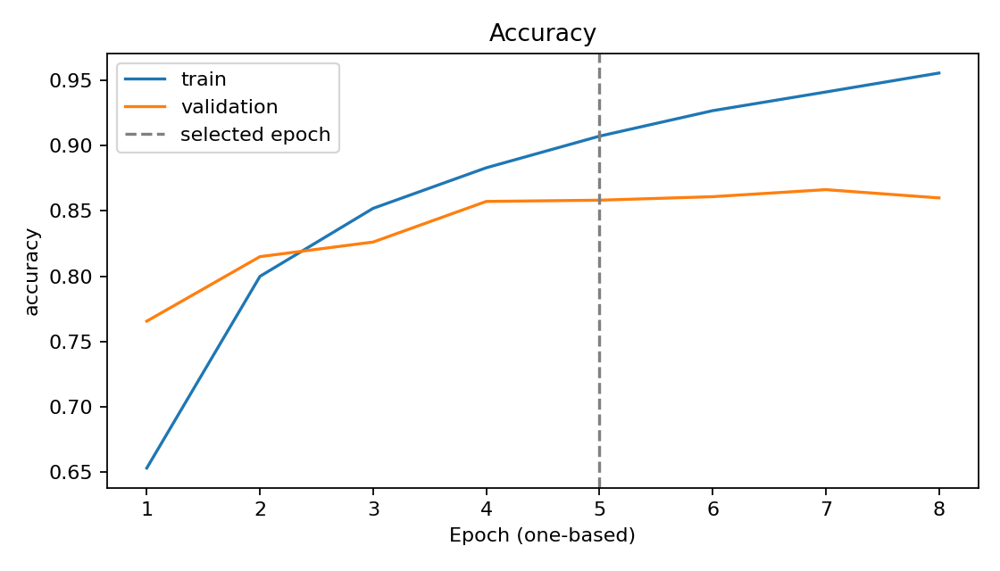

# IMDb Sentiment Analysis with LSTM

A PyTorch portfolio project for **English movie-review sentiment classification**,
with training-only vocabulary fitting, packed LSTM sequences, validation-only model
selection and portable inference artifacts.

**Verified experiment:** Accuracy **86.09%**, Macro-F1 **0.8607** on 7,436 held-out
reviews. **Final trained-model CPU inference: 8/8 tests passed**, with no retraining.
These claims come from the owner's returned Colab evidence, reviewed locally;
this final review did not rerun training, evaluation or inference.
Code/content licensing still awaits the owner's final review.

## Measured results

Run **run_20261105T101047_013570Z**, completed 2026-11-05.
[Experiment report](results/improved/run_20261105T101047_013570Z/reports/results.md) ·
[Exact metrics](results/improved/run_20261105T101047_013570Z/model/metrics.json) ·
[History](results/improved/run_20261105T101047_013570Z/model/history.json) ·
[Evidence guide](results/README.md)

| Item | Recorded result |
|---|---:|
| Test accuracy | 86.09% (0.8609467455621301) |
| Test Macro-F1 | 0.8607 (0.8607200451212895) |
| Test BCE loss | 0.3549927463449413 |
| Train / validation / test | 34,704 / 7,436 / 7,436 |
| Raw / unique normalized reviews | 50,000 / 49,576 |
| Selected epoch | 5, minimum validation loss 0.3639572282963507 |
| Epochs completed | 8; patience 3, maximum 10 |
| Training GPU / seed | Tesla T4 / 42 |
| Recorded training + final-test time | 72.53 seconds, excluding setup/tests/uploads |

Rows=true and columns=predicted, negative then positive:
[[3051, 653], [381, 3351]]. Accuracy and per-class/Macro-F1 are consistent with
this matrix. JSON, Markdown and the saved history agree; epoch logs were checked
at their printed precision. The original **86.29%** experiment is
[documented separately](reports/original_results.md): its split, full-corpus
vocabulary, padding and checkpoint-selection rule differ. The two scores are
**not a controlled before/after comparison**, and no superiority claim is made.

## Final saved-model CPU verification

[Final report](results/improved/run_20261105T101047_013570Z/final_inference/final_inference_report.json) ·
[Complete log](results/improved/run_20261105T101047_013570Z/final_inference/final_inference.log) ·
[Hash manifest](results/improved/run_20261105T101047_013570Z/final_inference/EVIDENCE_MANIFEST.json)

The real trained weights and saved metadata were loaded on Colab CPU:
**8 passed, 0 failures, 0 errors, 0 skips; inference_executed=true; retraining=false**.
The checkpoint/checker/source fingerprints match the recorded experiment.

Checks covered architecture, all seven tensor shapes, vocabulary/preprocessing,
two authored positive and two negative English reviews, seven empty/unsupported
input cases, unknown words, padding invariance, repeated predictions and reload.
All four review labels matched their expected diagnostic labels, and each reload
probability difference was **0.0**. No weights/files changed in the recorded check.
These four examples are diagnostics, not another accuracy estimate.
Inference environment: Python 3.13.18, torch 2.11.0+cpu, NumPy 2.4.6, one CPU thread.
The saved training-workflow evidence also records 35 tests with no skips/failures/errors
and a synthetic GPU smoke pass.

## Methodology and model

- Read the separately supplied CSV from Data/IMDB Dataset.csv, resolved relative
  to the project source. Raw data is never rewritten.
- Normalize English words with internal apostrophes; HTML/punctuation separate
  tokens. Reject empty/unsupported inputs.
- Deduplicate exact normalized text in memory; stratify 70/15/15 with seed 42.
  This custom split is not the official IMDb or a movie-group split.
- Fit vocabulary on **training only**: cap 20,000 including PAD=0 and UNK=1,
  minimum frequency 2, deterministic frequency/alphabetical ordering.
- Keep the first 200 tokens and true lengths. Packed sequences avoid interpreting
  padded steps as content.
- Select the best weights and early-stop on **validation loss only**, then evaluate
  test once using fixed threshold 0.5. Do not tune on test scores.

Architecture: Embedding(20000,100) → one-layer unidirectional LSTM(128) →
Dropout(0.5) → Linear(1) logits; **2,117,889 parameters**.
Training uses BCEWithLogitsLoss, Adam learning rate 0.001, batch 64,
gradient clipping at norm 1 and sample-weighted losses.

## Reproduce a new experiment

1. Obtain the CSV from the [owner-confirmed Kaggle source](https://www.kaggle.com/datasets/lakshmi25npathi/imdb-dataset-of-50k-movie-reviews)
   under its applicable terms; see [data instructions](Data/README.md).
2. From a clone/download of this source, create a data-free source capsule:

       python -B -m tools.package_colab

   This writes dist/lstm_sentiment_source_current.zip without touching the preserved
   historical source archive. Static portfolio result files are not embedded in
   this training capsule; their links are available in the full project.
3. Open [colab_gpu.ipynb](notebooks/colab_gpu.ipynb), select a free GPU runtime and
   Run all. Upload the new source ZIP, then the separate CSV.
4. All unit tests (zero skips), GPU smoke and input checks must pass before training.
   RUN_FULL_TRAINING=True launches a new experiment; False is verification only.
5. Download the resulting metrics/plots/model bundle. Never substitute its results
   for the historical run without a separate experiment record.

[COLAB.md](COLAB.md) covers outputs, dependency setup, optional Drive persistence
and interruption limits. Exact optimizer/RNG resume is not implemented.
Observed training environment: Python 3.13.16, torch 2.11.0+cu130, NumPy 2.4.6,
matplotlib 3.10.0, CUDA build 13.0, cuDNN 92700, Tesla T4.
Requirements are supported version ranges, not an exact environment lock.
Seeds/deterministic algorithms and source/data/split hashes are retained;
bit-identical results across hardware/library versions are not guaranteed.

## Inference without training

A public source checkout **does not include pretrained weights or vocabulary**.
Use an authorized model.pt plus metadata.json bundle; no CSV is needed:

    python -m sentiment.predict --artifact /path/to/authorized_artifact --text "The acting was excellent."

The loader verifies schema/checksum, maps weights to CPU and uses weights_only=True.
Use only trusted artifacts. Unknown words become UNK; empty/unsupported text raises
an error. positive_probability is the positive-class score, not calibrated confidence.

[FINAL_INFERENCE.md](FINAL_INFERENCE.md) and the
[CPU verification notebook](notebooks/final_inference_cpu.ipynb) document the completed
gate and how the owner can repeat it on the **pinned historical artifacts**.
That notebook needs the preserved private source/results ZIPs; it is not an
automatic test of newly trained or publicly downloadable weights.

## Source layout and tests

- sentiment/: preprocessing, model, training, metrics, inference, reporting and workflow.
- tests/: regression tests and the explicit no-training final-artifact checker.
- tools/: strict test runner and source packaging.
- notebooks/: full GPU workflow and independent CPU verification.
- results/: selected measured outputs and verification evidence.
- reports/original_results.md: separate historical original experiment.
- [artifacts/README.md](artifacts/README.md): local-only artifact instructions.

For a provisioned environment:

    python -B -m unittest discover -s tests -v

This suite includes tiny synthetic optimizer checks when PyTorch is installed;
ordinary unittest may skip them if absent. The strict Colab runner rejects skips.
Do not run that suite merely to inspect saved results if no model execution is intended.

## Rights and limitations

[LICENSING.md](LICENSING.md) separates code/content decisions from dataset/model
rights; [dependency review](DEPENDENCIES_AND_RIGHTS.md) links upstream licenses.
No project open-source license has been added pending the owner's final review.
Kaggle lists Other (specified in description); raw-data/model redistribution
permission is not established. CSV, original notebook excerpts, weights/vocabulary,
ZIPs, backups, environments and secrets are excluded from proposed publication.
Only aggregate results, generated charts and reviewed diagnostic evidence are included.

Limitations: one seed/custom split, no classical TF-IDF baseline, first-200-token
English regex input, no near-duplicate/movie-group control, calibration or
out-of-domain validation. Overfitting remains visible after epoch 5. The notebook
is a reproducible portfolio experiment, not a production or state-of-the-art claim.

## References

- [Maas et al., Learning Word Vectors for Sentiment Analysis, ACL 2011](https://aclanthology.org/P11-1015/)
- [Stanford Large Movie Review Dataset](https://ai.stanford.edu/~amaas/data/sentiment/index.html)
- [PyTorch reproducibility](https://docs.pytorch.org/docs/stable/notes/randomness.html)
