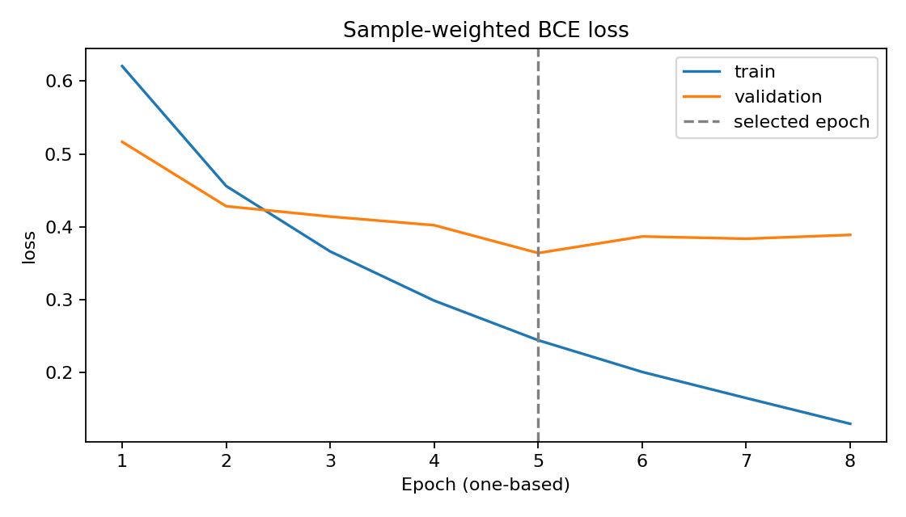
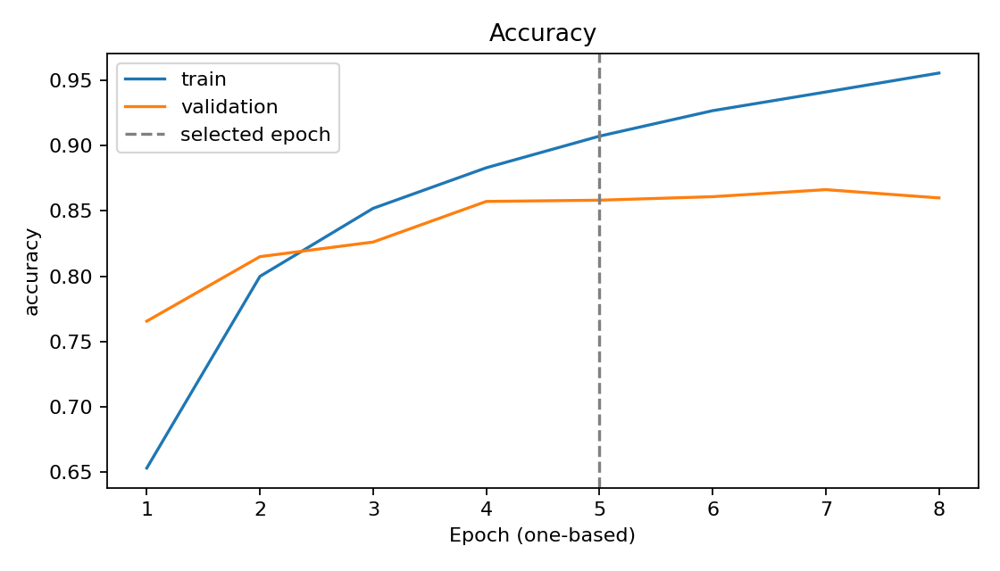
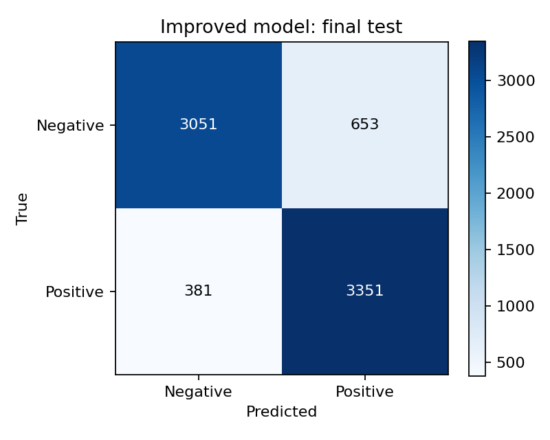

# Improved LSTM: completed experiment

Created UTC: 2026-11-05T10:21:33.841566+00:00

Selection: lowest validation loss; epoch 5. Test was evaluated after selection, with a fixed 0.5 probability threshold.

| Final test metric | Measured value |
|---|---:|
| Samples | 7436 |
| Accuracy | 0.860947 |
| Macro-F1 | 0.860720 |
| BCE loss | 0.354993 |

The original notebook stored 86.29% accuracy under a different protocol. It is historical and is not the score or a directly comparable baseline for this run.

Limitations: English-only tokens, first-200-token truncation by default, one seed, custom random split, no movie-group separation, near-duplicate control, calibration or out-of-domain validation. No superiority claim is made.
